# iArchitect — iOS Architecture Learning App

> **Learn iOS architecture patterns through live, interactive code — not static blog posts.**

## Screenshots

### Architectures Hub
| Hub — all 6 patterns | MVVM Live Demo | MVVM Code Viewer |
|:---:|:---:|:---:|
| 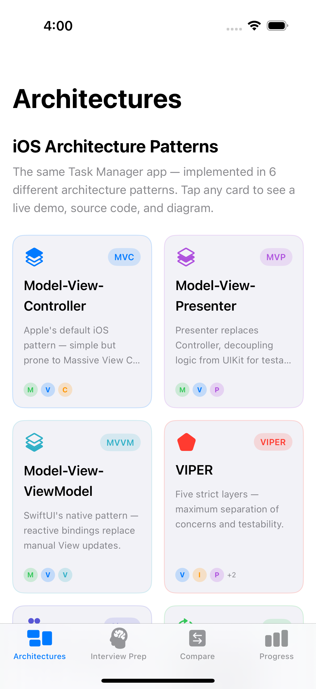 | 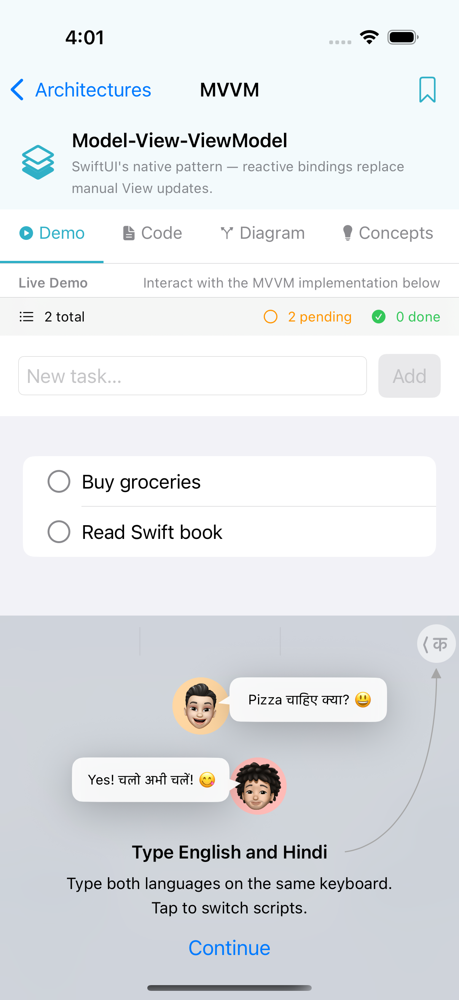 | 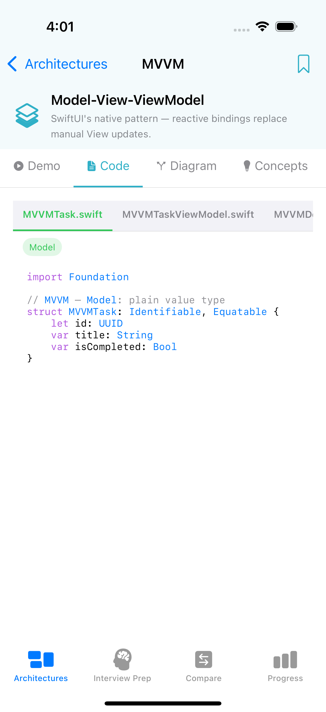 |

### Architecture Detail Views
| Data Flow Diagram | Concepts & Layers | VIPER Demo |
|:---:|:---:|:---:|
| 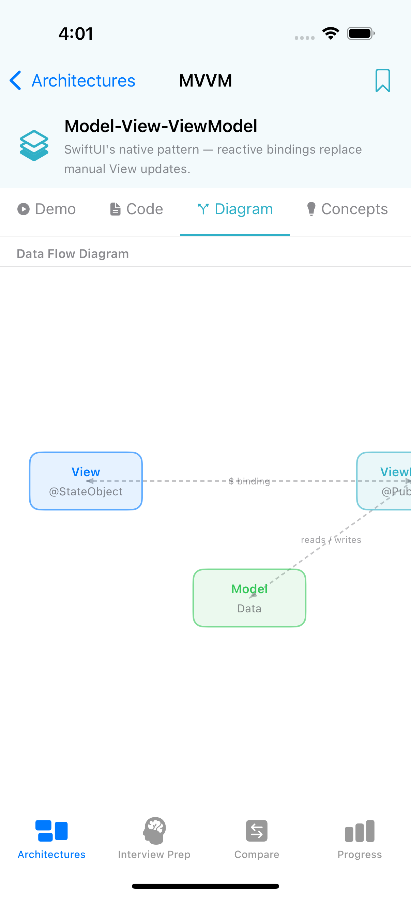 | 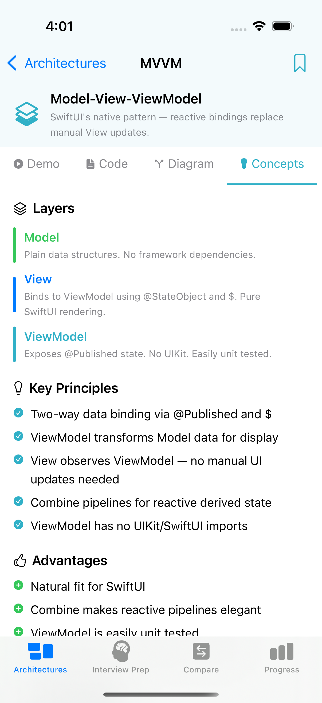 | 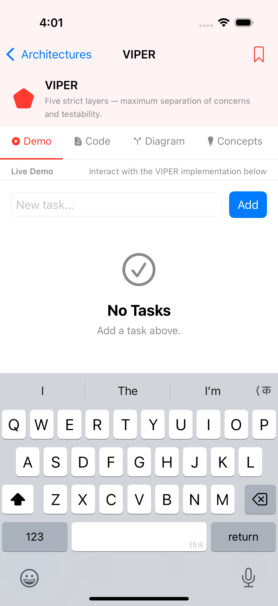 |

| VIPER Diagram | TCA — Action Log | Clean Architecture |
|:---:|:---:|:---:|
| 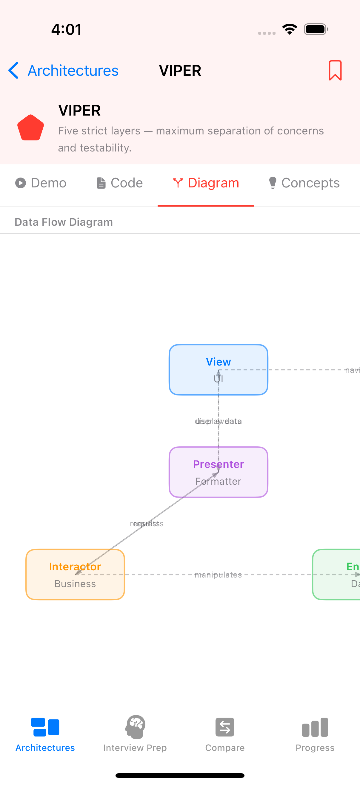 | 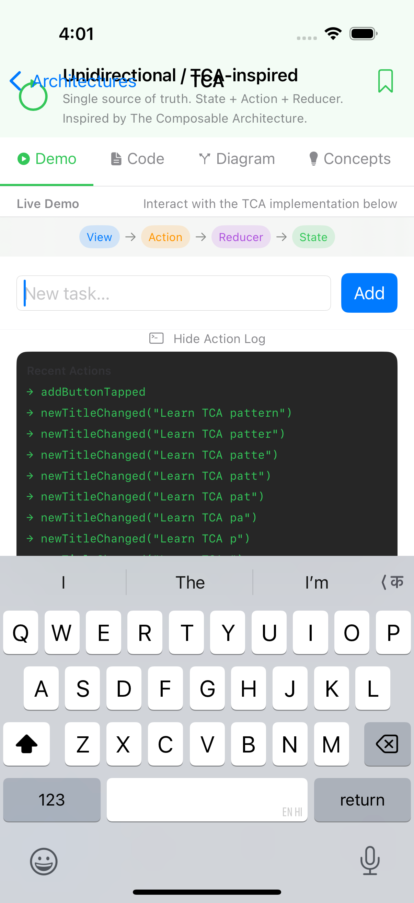 | 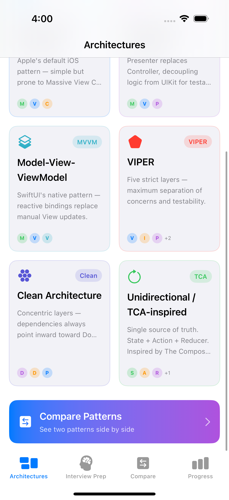 |

### Interview Prep
| Topic List | Topic Overview | Code Examples |
|:---:|:---:|:---:|
| 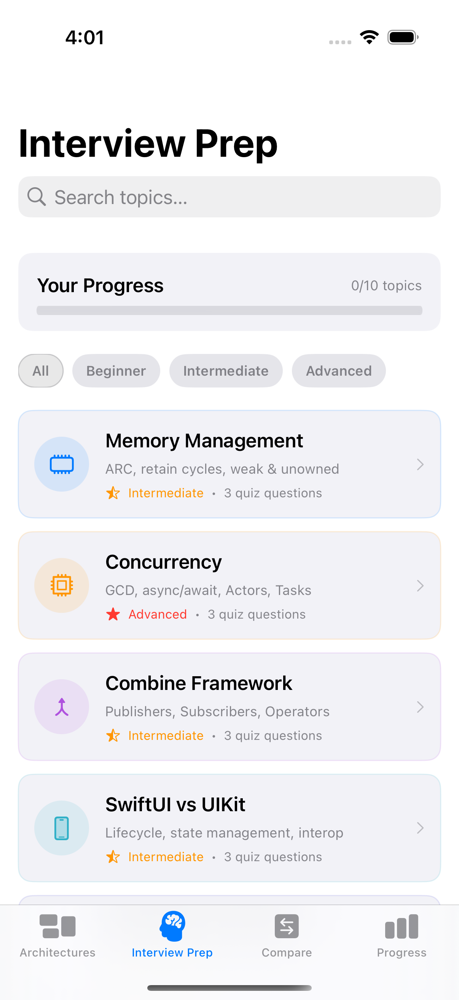 | 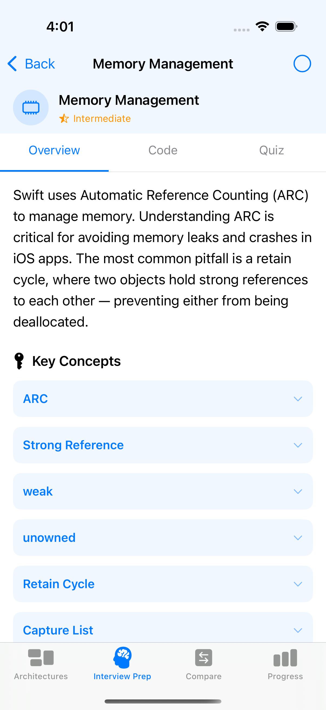 | 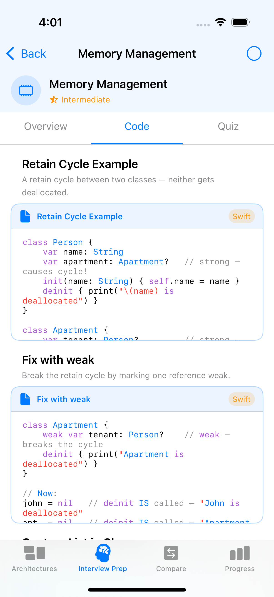 |

### Quiz Engine
| Quiz Question | Answer Feedback | Next Question |
|:---:|:---:|:---:|
| 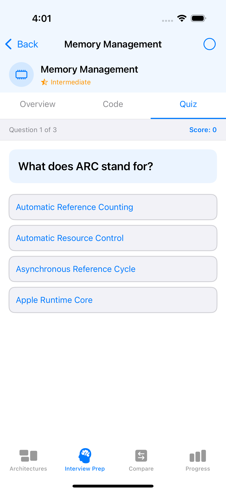 | 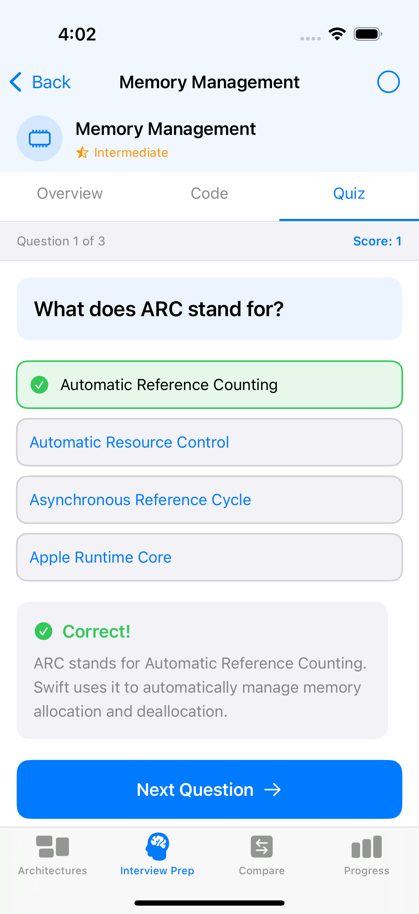 | 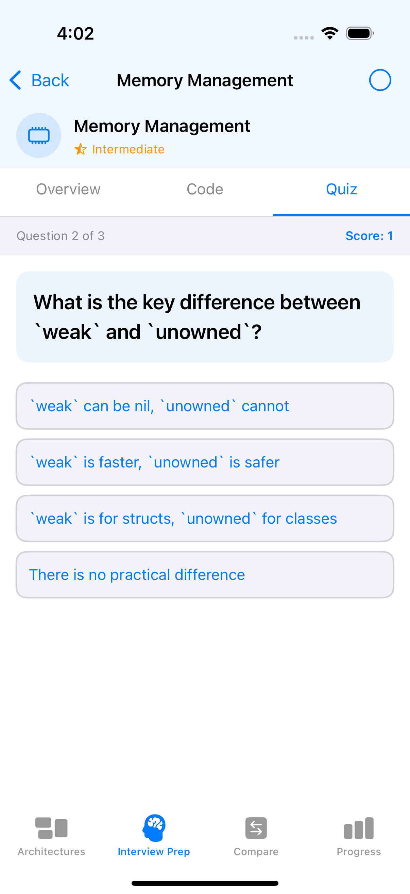 |

### Comparison & Progress
| Comparison — Layers | Comparison — Pros/Cons | Progress Dashboard |
|:---:|:---:|:---:|
| 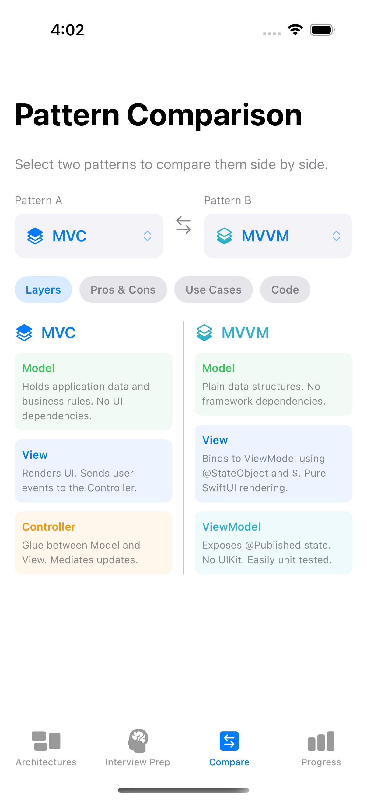 | 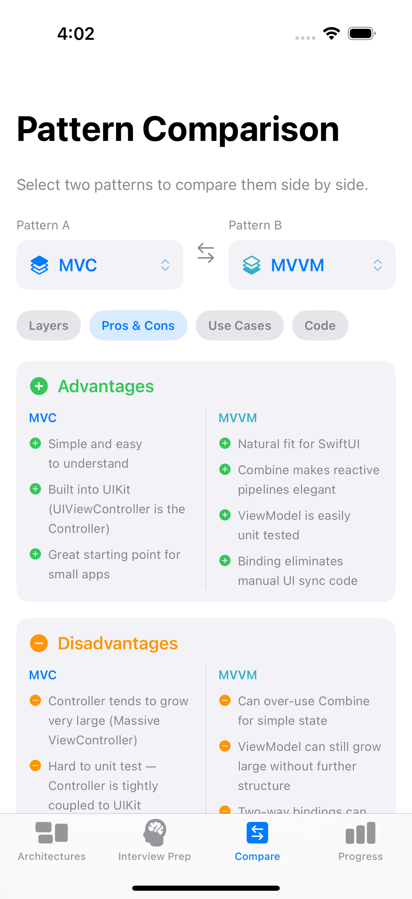 | 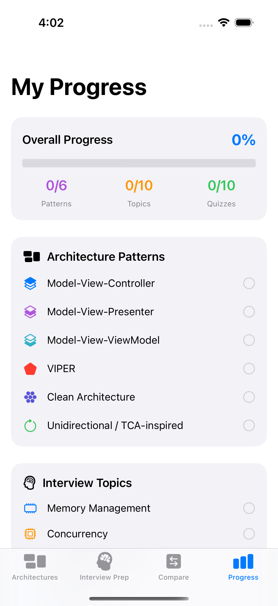 |

---

iArchitect teaches **MVC, MVP, MVVM, VIPER, Clean Architecture, and TCA** by building the *exact same Task Manager app* in every pattern, side by side in one container app. Every pattern comes with a live running demo, syntax-highlighted source code, an animated data-flow diagram, and a concepts guide. An Interview Prep section covers 10 core iOS topics with code snippets and quizzes.

---

## Features

| Section | What you get |
|---|---|
| **Architectures** | 6 patterns, each with Live Demo · Code Viewer · Diagram · Concepts |
| **Interview Prep** | 10 topics, each with overview · key concepts · code · 3-question quiz |
| **Compare** | Side-by-side diff of any two patterns — layers, pros/cons, code |
| **Progress** | Tracks completed patterns & topics, quiz scores, best scores |

---

## Architecture Patterns

### MVC — Model-View-Controller
Apple's default iOS pattern. The Controller mediates between Model and View. Simple but prone to the **Massive ViewController** anti-pattern as apps grow.

```
User → View → Controller → Model
                ↑              |
                └──────────────┘
```

| Layer | File | Role |
|---|---|---|
| Model | `MVCTaskModel.swift` | Pure data + business rules. No UI knowledge. |
| Controller | `MVCTaskController.swift` | Mediates between Model and View. |
| View | `MVCDemoView.swift` | Renders UI, calls Controller on user events. |

---

### MVP — Model-View-Presenter
Replaces the Controller with a **Presenter** that communicates with the View only via a protocol — making it fully unit-testable without UIKit.

```
User → View ←→ Presenter → Model
       (passive,    (all logic,
        protocol)    no UIKit)
```

| Layer | File | Role |
|---|---|---|
| Model | `MVPTask.swift` · `MVPTaskStore.swift` | Plain data + in-memory store. |
| Presenter | `MVPTaskPresenter.swift` | ALL logic. Zero UIKit imports. Testable. |
| View | `MVPDemoView.swift` | Passive — only renders and delegates events. |

**Key concept:** `MVPTaskViewProtocol` defines what the Presenter can ask the View to do, enabling mock views in unit tests.

---

### MVVM — Model-View-ViewModel
SwiftUI's native pattern. The ViewModel exposes **`@Published`** state the View observes via Combine. Two-way binding replaces manual UI sync code.

```
View ←──$binding──→ ViewModel ←→ Model
     (observes                 (reads/writes)
      @Published)
```

| Layer | File | Role |
|---|---|---|
| Model | `MVVMTask.swift` | Plain value type. |
| ViewModel | `MVVMTaskViewModel.swift` | `@Published` state + Combine pipelines. Zero UIKit. |
| View | `MVVMDemoView.swift` | Binds to ViewModel with `@StateObject` and `$`. |

**Key concept:** A Combine pipeline (`$tasks.map { … }.assign(to: &$completedCount)`) derives `completedCount` reactively — no manual updates needed.

---

### VIPER — View · Interactor · Presenter · Entity · Router

Five strictly separated layers connected only via protocols — maximum testability and separation of concerns.

```
View ←→ Presenter ←→ Interactor ←→ Entity
  ↓                              
Router (wires all layers + handles navigation)
```

| Layer | File | Role |
|---|---|---|
| Entity | `VIPERTaskEntity.swift` | Plain data struct. No logic. |
| Interactor | `VIPERTaskInteractor.swift` | ALL business logic. Never imports UIKit. |
| Presenter | `VIPERTaskPresenter.swift` | Formats data for display. Bridges View ↔ Interactor. |
| Router | `VIPERTaskRouter.swift` | Navigation + module assembly (the only class that knows all layers). |
| View | `VIPERDemoView.swift` | Completely passive. Delegates every event to Presenter. |

**Key concept:** The `VIPERTaskAssembler` in the Router is the only place all five components are instantiated and wired — keeping every other layer decoupled.

---

### Clean Architecture

Three concentric layers following the **Dependency Rule** — source code dependencies always point inward toward Domain.

```
  ┌─────────────────────────────┐
  │  Presentation (ViewModel)   │
  │  ┌────────────────────┐     │
  │  │  Domain (UseCase)  │     │
  │  │  ┌────────────┐   │     │
  │  │  │  Entity    │   │     │
  │  │  └────────────┘   │     │
  │  └────────────────────┘     │
  │  Data (Repository impl.)    │
  └─────────────────────────────┘
```

| Layer | Files | Role |
|---|---|---|
| Domain | `CleanTask.swift` · `CleanTaskUseCase.swift` | Entities + Use Cases. **Zero framework dependencies.** |
| Data | `CleanTaskRepository.swift` | Implements `CleanTaskRepositoryProtocol`. Only layer that knows about data sources. |
| Presentation | `CleanTaskViewModel.swift` · `CleanDemoView.swift` | ViewModel depends on Use Cases (Domain), never on Repository (Data). |

**Key concept:** `CleanTaskRepositoryProtocol` is defined in Domain but implemented in Data — the Dependency Inversion Principle. Domain never imports Data.

---

### TCA-Inspired — Unidirectional Data Flow

Inspired by [The Composable Architecture](https://github.com/pointfreeco/swift-composable-architecture) by Point-Free. Strict one-way data flow — State can only change via the Reducer.

```
View ──sends──→ Action ──→ Reducer ──mutates──→ State
  ↑                                                |
  └──────────── @Published (Store) ←──────────────┘
```

| Primitive | File | Role |
|---|---|---|
| `TCATaskState` | `TCATaskFeature.swift` | Immutable snapshot of all UI state. Single source of truth. |
| `TCATaskAction` | `TCATaskFeature.swift` | Exhaustive enum — every possible event is a case. |
| `TCATaskReducer` | `TCATaskFeature.swift` | Pure function `(inout State, Action) → Void`. No side effects. |
| `TCATaskStore` | `TCATaskFeature.swift` | Holds State. Routes Actions through Reducer. |
| View | `TCADemoView.swift` | Reads `store.state`. Sends Actions via `store.send(_:)`. Zero logic. |

**Key concept:** The in-app **Action Log** panel shows every dispatched Action in real time — demonstrating the full unidirectional flow as you interact.

---

## Interview Prep

10 topics, each with key concepts, code examples, and a 3-question quiz:

| # | Topic | Difficulty |
|---|---|---|
| 1 | **Memory Management** — ARC, retain cycles, `weak`/`unowned`, capture lists | Intermediate |
| 2 | **Concurrency** — GCD, `async/await`, `Actor`, `@MainActor`, `Task` | Advanced |
| 3 | **Combine Framework** — Publishers, Subscribers, `sink`, `assign`, operators | Intermediate |
| 4 | **SwiftUI vs UIKit** — Declarative vs imperative, `UIViewRepresentable`, `UIHostingController` | Intermediate |
| 5 | **Dependency Injection** — Constructor, property, method DI, protocol-based | Intermediate |
| 6 | **Design Patterns** — Singleton, Factory, Observer/Delegate, Coordinator | Intermediate |
| 7 | **Networking** — `URLSession`, `Codable`, `CodingKeys`, generic async fetch layer | Intermediate |
| 8 | **Core Data** — `NSPersistentContainer`, `NSManagedObjectContext`, `@FetchRequest` | Advanced |
| 9 | **Testing** — `XCTestCase`, mocks/stubs/spies, `@testable import`, Given/When/Then | Intermediate |
| 10 | **Swift Fundamentals** — Value vs reference types, generics, `@escaping`, optionals | Intermediate |

---

## Project Structure

```
iArchitect/
├── App/
│   ├── iArchitectApp.swift         ← @main entry point
│   └── MainTabView.swift           ← 4-tab navigation shell
│
├── Modules/                        ← One folder per architecture pattern
│   ├── MVC/
│   │   ├── MVCTaskModel.swift
│   │   ├── MVCTaskController.swift
│   │   └── MVCDemoView.swift
│   ├── MVP/
│   │   ├── MVPTask.swift
│   │   ├── MVPTaskPresenter.swift
│   │   └── MVPDemoView.swift
│   ├── MVVM/
│   │   ├── MVVMTask.swift
│   │   ├── MVVMTaskViewModel.swift
│   │   └── MVVMDemoView.swift
│   ├── VIPER/
│   │   ├── VIPERTaskEntity.swift
│   │   ├── VIPERTaskInteractor.swift
│   │   ├── VIPERTaskPresenter.swift
│   │   ├── VIPERTaskRouter.swift
│   │   └── VIPERDemoView.swift
│   ├── CleanArch/
│   │   ├── Domain/
│   │   │   ├── CleanTask.swift
│   │   │   └── CleanTaskUseCase.swift
│   │   ├── Data/
│   │   │   └── CleanTaskRepository.swift
│   │   └── Presentation/
│   │       ├── CleanTaskViewModel.swift
│   │       └── CleanDemoView.swift
│   └── TCA/
│       ├── TCATaskFeature.swift
│       └── TCADemoView.swift
│
├── ArchitectureHub/
│   ├── ArchitectureData.swift      ← All pattern metadata + code snippets
│   ├── ArchitectureHubView.swift   ← Grid of pattern cards
│   ├── ArchitectureDetailView.swift← Tabbed detail (Demo/Code/Diagram/Concepts)
│   ├── DiagramView.swift           ← Animated SwiftUI Canvas diagrams
│   ├── CodeViewerView.swift        ← Syntax-highlighted code viewer
│   └── SyntaxHighlighter.swift     ← NSAttributedString + regex highlighter
│
├── InterviewPrep/
│   ├── InterviewTopic.swift        ← Data models (topic, concept, snippet, quiz)
│   ├── TopicsData.swift            ← All 10 topics with content + quizzes
│   ├── InterviewPrepView.swift     ← Topic list with search + filter
│   ├── TopicDetailView.swift       ← Overview / Code / Quiz tabs
│   └── QuizView.swift              ← Interactive quiz + results
│
├── Comparison/
│   └── ComparisonView.swift        ← Side-by-side pattern comparison
│
└── Progress/
    ├── ProgressStore.swift         ← ObservableObject, UserDefaults persistence
    └── ProgressView.swift          ← Progress dashboard + quiz score history
```

---

## Technical Highlights

### Syntax Highlighter (no external dependencies)
`SyntaxHighlighter.swift` uses `NSRegularExpression` + `NSMutableAttributedString` to colour Swift code by token type:

| Token | Colour |
|---|---|
| Keywords (`class`, `func`, `let`, …) | Purple |
| Type names (PascalCase) | Blue |
| String literals | Red |
| Comments | Grey |
| `@attributes` | Orange |
| Numbers | Teal |

Rendered in a `UITextView` (via `UIViewRepresentable`) for smooth scrolling and native text selection.

### Animated Diagrams
`DiagramView.swift` uses **SwiftUI `Canvas`** to draw nodes and dashed arrows. Nodes animate in with a `.scaleEffect` + `.opacity` transition when the tab appears. Arrow labels appear alongside the edges to explain each connection.

### Progress Persistence
`ProgressStore` uses `UserDefaults` (via `Set<String>` serialisation) to persist:
- Completed pattern IDs
- Completed topic IDs
- Quiz scores per topic (`bestScore`, `lastScore`, `attempts`)

No external database — lightweight and instant.

---

## Requirements

| Requirement | Version |
|---|---|
| Xcode | 15.0+ |
| iOS Deployment Target | 17.0+ |
| Swift | 5.9+ |
| External dependencies | **None** |

---

## Getting Started

```bash
# 1. Clone the repo
git clone https://github.com/Aishwaryaofficial/iArchitect.git
cd iArchitect

# 2. Open in Xcode
open iArchitect.xcodeproj

# 3. Select any iOS Simulator and Run (⌘R)
```

> No SPM package resolution needed — the app has zero external dependencies.

---

## How to Regenerate the Xcode Project

The project uses [XcodeGen](https://github.com/yonaskolb/XcodeGen) so the `.xcodeproj` is always reproducible from `project.yml`:

```bash
brew install xcodegen
xcodegen generate
```

---

## Learning Path (Suggested)

1. **Start with MVC** — simplest pattern, already familiar from UIKit tutorials
2. **Move to MVP** — understand why the Presenter protocol makes testing possible
3. **Try MVVM** — see how `@Published` + Combine eliminates manual sync
4. **Tackle VIPER** — five strict layers, compare the boilerplate cost vs testability gain
5. **Explore Clean Architecture** — learn the Dependency Rule and why Domain must stay pure
6. **Finish with TCA** — unidirectional flow and the Action Log make state changes visible
7. **Do the Interview Prep** — quiz yourself on memory, concurrency, and Swift fundamentals

---

## License

MIT License — see [LICENSE](LICENSE) for details.

---

*Built with ❤️ using SwiftUI, Combine, and zero external dependencies.*
